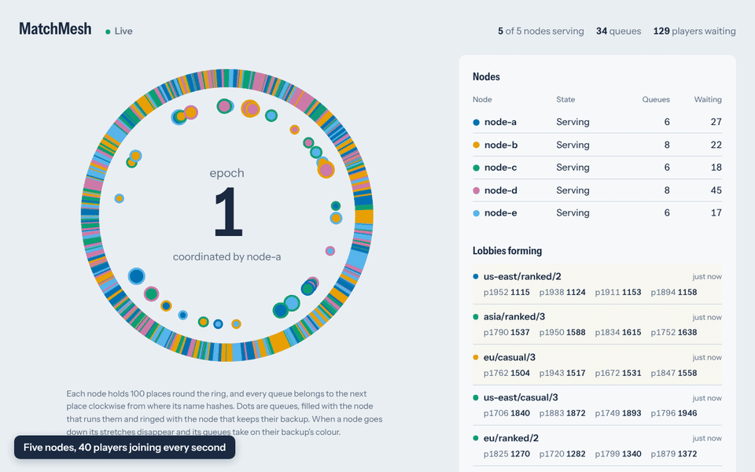
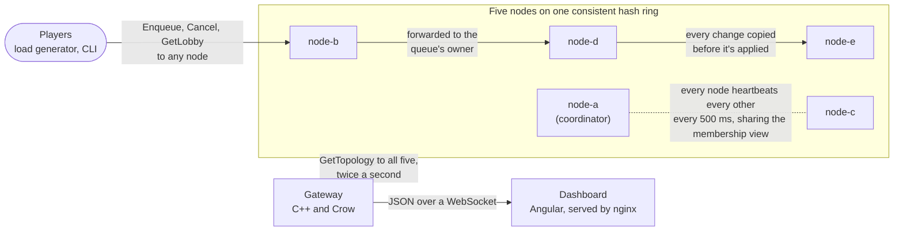
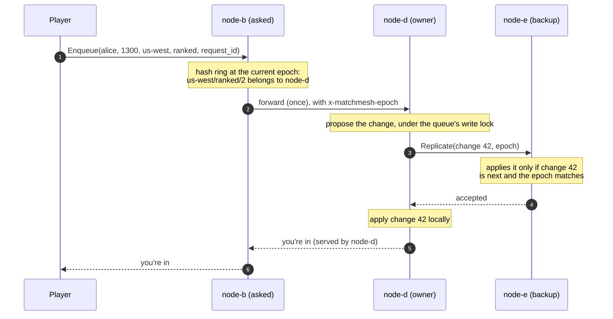

# MatchMesh

**The backend that puts players into matches**, like the one behind "Find match"
in an online multiplayer game. Players join a queue, and the system groups
people of similar skill into four-player lobbies. MatchMesh runs that across a
cluster of five servers, so matches keep forming even when one of them crashes.

**Why that's hard:** each server holds some of the queues in memory. If a
server dies, the players waiting on it would vanish, and if two servers both
think they own a queue, a player can end up in two matches at once. MatchMesh
copies every change to a second server before telling the player "you're in",
detects a crashed server within 1.5 seconds, and moves its queues to their
backups. In chaos testing it lost **0 of 79,000 players** across 11 crashes.

**[▶ Try the live demo](https://rishon-g.github.io/matchmesh/)**. It runs in
your browser, with nothing to install: crash servers, cut the network in two,
and watch whether any player is lost. (It's the real C++ code compiled to
WebAssembly, not an animation.)

**Under the hood:** C++20 and gRPC. Queues are sharded across nodes with
consistent hashing, replicated with synchronous primary-backup replication,
and moved by a heartbeat-based membership protocol with epoch-numbered views.
A live dashboard shows the hash ring rebalancing as it happens.



*Above: `kill -9` on node-c while 40 players a second keep joining. Its
stretches of the ring disappear and its queues fail over to their backups; when
it restarts with an empty memory, it rejoins and the queues are handed back.
Recorded against five real node processes.*

## Results

All real measures: five node processes and the load generator sharing
one 2-core machine.

| What | Measured |
|---|---|
| **Failover** after `kill -9` | queue serving again from its backup in **1.3 to 1.5 s** (target was under 2 s) |
| **Players lost** in chaos testing | **0** across 11 kills and 79,000 players, including 29,000 players with 3 kills at 1,000/s |
| **Enqueue latency** at 1,000 players/s | **p50 0.78 ms, p99 3.07 ms**, including forwarding and synchronous replication |
| **Throughput** | about **4,000 players/s** before saturating the 2 cores |
| **Tests** | **244** C++ tests (178 of them also under ThreadSanitizer) and 22 dashboard tests |

**Built with** C++20, gRPC and Protocol Buffers, CMake presets, GoogleTest and
ThreadSanitizer, Docker Compose, a [Crow](https://crowcpp.org) WebSocket
gateway, an Angular 22 dashboard with RxJS, and Emscripten (WebAssembly) for
the in-browser demo, deployed to GitHub Pages by GitHub Actions.

## Quick start

```bash
docker compose up -d --build       # five nodes, the gateway and the dashboard
open http://localhost:8080         # the live dashboard
docker compose run --rm loadgen    # 10,000 simulated players
docker compose kill node-c         # kill a node and watch it fail over
./scripts/chaos.sh                 # kill random nodes under load, then check nobody was lost
```

## Architecture



| Component | What it does |
|---|---|
| [`core/`](core) | The matchmaking engine, hash ring, membership logic and replication rules. Pure C++, no networking, so all of it is unit-tested in isolation |
| [`node/`](node) | The gRPC server around the engine: routing and forwarding, heartbeats, replication, hand-overs |
| [`loadgen/`](loadgen) | Simulates thousands of players, records latency histograms, and checks the lost-player invariants |
| [`gateway/`](gateway) | Polls every node and pushes one merged picture of the cluster to browsers over a WebSocket |
| [`dashboard/`](dashboard) | The Angular app: the hash ring, node health and lobbies, live |
| [`scripts/chaos.sh`](scripts/chaos.sh) | Kills random nodes during a load test and checks nobody was lost |

One enqueue, start to finish. The player can ask any node; the change exists
on two nodes before anyone is told it worked:



## How it works

### Sharding with consistent hashing

Players are sharded by **queue** (region, game mode and a 500-point skill
bracket), not by player, because everyone who could be matched together has to
live on the same node. Each node sits at **100 points** on a 64-bit hash ring,
and a queue belongs to the first point clockwise from its own hash. With 5 nodes
and 10,000 queues, every node owns within about 14% of an even share, and
removing a node moves only its own queues (about 17%, near the ideal 1/5,
where `hash % nodes` would move about 80%). The ring depends only on which
nodes are in it, so every node computes the same one independently.

### Any node accepts any request

Each node's router knows the whole ring, so a request for another node's queue
is forwarded to its owner, exactly once: the forwarded copy is marked and never
forwarded again, so a misconfigured cluster fails fast instead of looping.
Replies say which node really served them.

### Failure detection and membership

Every node heartbeats every other node every **500 ms**; one silent for
**1.5 s** is suspected dead. Suspicion is only a node's private opinion, so
routing never follows it directly. The **coordinator** (the alive node with the
lowest ID) turns its suspicions into an agreed **view**: the member list plus an
**epoch** number that goes up on every change. Views spread on the heartbeats
themselves, and each router swaps in a whole new ring per epoch, so a request is
routed entirely by one epoch or the next, never a mix. If the coordinator dies,
the next-lowest node simply publishes the next epoch itself.

A node that crashes and restarts before anyone notices is caught by its
**incarnation number**, picked at random on every start (the idea comes from the
SWIM protocol): a new number means a new process with an empty memory, so it
gets a new epoch and its queues back.

### Synchronous primary-backup replication

Each queue's **backup** is the next distinct node clockwise, which is also the
node that will own it if the primary dies, so failover needs no data movement.
Every change, whether a join, a cancel or a lobby forming, takes the same path
under the queue's write lock: **propose, copy to the backup, then apply**. If the
copy fails nothing changes and the player gets a retryable error, so nobody is
ever told "you're in" while only one node knows it.

- **Lobbies are atomic.** A lobby is one replicated change with a unique ID and
  all four players, so a failover can't leave half of it formed or match anyone
  twice.
- **Strict order.** Changes carry per-queue sequence numbers; a backup applies
  only the exact next one. Anything else triggers a full snapshot, which also
  brings brand-new backups up to date.
- **Stale nodes can't write.** Replication is accepted only at the receiver's
  exact epoch and only from that queue's primary.

### Failover and rejoin

After every epoch change, each node hands any queue it no longer owns to its new
owner and brings its own queues' backups up to date. A queue's new owner starts
serving only once **every member has reported its hand-over finished** for that
epoch, so it always starts from the newest copy, never from nothing. That covers
both directions: a backup taking over from a dead primary, and a restarted node
getting its queues back.

### Exactly-once joins

A client sends an **idempotency key** with each join and reuses it on every
retry. If an earlier attempt worked and only its reply was lost, the retry is
recognised, by the primary or by the backup that took over (the key is
replicated), and answered with the original result instead of joining the
player twice.

### The matchmaking engine

Each queue keeps its players sorted by rating. A lobby of four forms when the
rating spread fits a window that starts at 50 points and widens by 10 per second
of waiting (up to 300), with the longest-waiting player deciding, so nobody is
starved by newcomers. A fixed pool of worker threads matches in the background.
Every queue has its own lock (**lock striping**), which roughly doubled
throughput over a single global lock (about 290k to 580k players/s in-process).

### Gateway and dashboard

Browsers can't call gRPC, so the **gateway** asks all five nodes for their
topology twice a second, at the same time and with a 300 ms deadline each (a
dead node costs one timeout, not one per node). It merges five partial answers
into one JSON picture and pushes it over a WebSocket, but only when something
changed. The **dashboard** draws the real ring from that data as SVG: every
node's 100 points, every queue at its hash position, coloured by its primary and
ringed by its backup.

## Benchmarks

`matchmesh_loadgen` simulates realistic traffic: **Poisson arrivals** (random
gaps around the target rate), **bell-curve ratings** (mean 1500, standard
deviation 300) and weighted regions and modes, all reproducible from a seed. It
is **open-loop**: each player is sent at their scheduled time whether or not
earlier calls have returned, and latency is measured from that time. A tester
that waits for each reply quietly slows down whenever the server does, hiding
the very stalls it should catch (*coordinated omission*). Latencies go into
HdrHistogram-style log-linear histograms, accurate to within 1.6% at any scale.

| Offered load (10,000 players) | Achieved | p50 | p90 | p99 | p99.9 |
|---|---|---|---|---|---|
| 1,000/s | 989/s | 0.78 ms | 1.28 ms | 3.07 ms | 8.45 ms |
| 3,000/s | 2,963/s | 1.82 ms | 6.97 ms | 22.0 ms | 37.9 ms |
| 6,000/s (past saturation) | 3,980/s | 483 ms | 762 ms | 868 ms | 1.02 s |

Every enqueue is three gRPC hops (the node asked, the owner, its backup), and up
to about 3,000 players/s each one is answered in milliseconds. Throughput tops
out near 4,000 players/s whether the client uses 8 threads or 128, so the limit
is the 2 CPU cores. Beyond that, open-loop measurement reports the backlog
honestly instead of hiding it.

**Time to lobby** at 1,000/s (how long matchmaking itself took): p50 108 ms, p90
623 ms, p99 5.2 s. The long tail is players with rare ratings waiting for their
match window to widen, which is the matchmaker trading quality for wait time as
designed. Of 10,000 players, 9,916 were in 2,479 lobbies, 84 were still waiting
in queues too thin to fill a lobby, and **none were lost**.

Load per node was uneven (1,387 to 3,146 players): with sharding by queue and a
bell curve of ratings, a few popular queues are much bigger than the rest, and a
queue can't be split across nodes. A production system would split skill
brackets more finely where players are dense.

## Chaos testing

[`scripts/chaos.sh`](scripts/chaos.sh) runs the load generator while it kills
random nodes with `kill -9`, measures how long the cluster takes to drop each
one, restarts it with an empty memory and measures its rejoin. It runs against Docker
Compose or (with `--local`) plain processes, and a seed replays the same run.

After every load test, the **invariant checker** confirms that each player who
was told "you're in" is in **exactly one** place: one consistent lobby (four
players from one queue, all agreeing on who's in it), or still queued. It fails
the run on any player who was lost, is in two places, or turned up after being
told their join failed.

| Run | Players | Kills | Lost | In two lobbies | Longest wait | Dead node dropped after |
|---|---|---|---|---|---|---|
| 2 rounds at 500/s, 4 seeds | 12,500 each | 8 | **0** | **0** | 1.56 to 2.07 s | 1.10 to 1.55 s |
| 3 rounds at 1,000/s | 29,000 | 3 | **0** | **0** | 1.90 s | 1.18 to 1.47 s |

Only players whose queue lived on the killed node (7 to 10% of them) waited up
to about 2 s; everyone else saw normal millisecond latencies.

**What it caught.** The first chaos runs failed, and fixing what they found made
the system correct:

1. **Lobby IDs reused after a restart.** A restarted node's lobby counter began
   again at 1 and handed out IDs its previous run had already used. IDs now
   include the run's incarnation number.
2. **A retry could put a player in two lobbies.** The node relaying a join died
   after the owner had added the player; the client never heard back and
   retried after the player had already been matched. Joins now carry an
   idempotency key, replicated with the queue.

Both have regression tests that fail if the old behaviour comes back.

## The in-browser demo

The [live demo](https://rishon-g.github.io/matchmesh/) is not an animation. It
runs the same `core/` code as the real nodes: `core::Membership` detecting
failures and publishing views, `core::MatchmakingEngine` matching players, and
`core::ShardCoordinator` replicating, handing over and taking over queues.
Only the network and the clock are simulated (`sim/`): five nodes exchange
heartbeats and replication messages as function calls that fail when a node is
down or on the other side of a split, on a virtual clock that fires every timer
at the same moments a real node would. Clients arrive at a set rate and retry
with idempotent request IDs, like the load generator.

To make that possible, the decisions in `node::ShardManager` and
`node::ReplicationClient` live in `core/` behind two small interfaces (where a
queue lives, and how to send a copy), and the node layer only adds gRPC and a
thread. `demo/` compiles `core/` and `sim/` to one WebAssembly module with
Emscripten, and the dashboard's demo build drives it in step with the display.
After every 250 ms of simulated time the simulator checks every live node's
copies for lost players, players in two lobbies and queues served twice, and
the page shows the counts.

```bash
emcmake cmake --preset wasm && cmake --build --preset wasm   # build/wasm/demo/matchmesh-sim.mjs
cp build/wasm/demo/matchmesh-sim.mjs dashboard/public/sim/
cd dashboard && npm run start:demo                            # http://localhost:4200/matchmesh/
```

## Known limitation: split brain, and how Raft would fix it

This is a failure detector, not a consensus protocol, and a node can't tell
"that node crashed" from "I can't reach that node". If the network splits the
cluster in two (say `a, b` and `c, d, e`), each side declares the other dead,
`node-a` coordinates one side and `node-c` the other, and both keep serving the
same queues, each replicating to a backup on its own side. Epoch checks don't
help, because each side's epochs are consistent on their own. When the split
heals the higher epoch wins, and whatever the losing side did to those queues is
overwritten. The live demo shows exactly this: press **Split the network**,
then heal it.

**Raft** prevents this by requiring a **majority** (3 of 5) for every
membership change: a leader is elected by a majority, and a new view is
committed only once a majority has acknowledged it. The smaller side of a split
can never reach a majority, so it stops making changes instead of forming a
second cluster, and every committed view is known to at least one node of any
future majority. The price is availability: a cluster that has lost its
majority refuses changes until enough nodes return.

## Engineering practices

- **Layered for testing.** Everything in `core/` is pure logic with time passed
  in, so failure detection is tested to the millisecond without sleeping.
  Replication is tested by mirroring hundreds of random changes into a second
  engine and comparing them field by field.
- **Real clusters in tests.** `tests/node/` starts three real gRPC nodes
  in-process and crashes and restarts them, quickly and slowly, one or two at a time.
- **ThreadSanitizer.** The engine, replication and membership code run under TSan
  in stress tests that hammer them from many threads at once.
- **Mutation testing.** Key safety checks were deliberately broken, one at a
  time, to confirm a test fails for each. That exercise exposed gaps, which got
  new tests.
- **Chaos and invariants.** As above: randomised kills under load, with every
  player accounted for afterwards.

## Building from source

The repository builds in a container, so the toolchain is identical everywhere:

```bash
docker build -t matchmesh-dev .
docker run --rm -it -v "$PWD":/workspace matchmesh-dev
cmake --preset debug && cmake --build --preset debug && ctest --preset debug
```

Presets: `debug`, `release` and `tsan` (ThreadSanitizer). Each GoogleTest case is
its own ctest test, so `ctest --preset debug -R HashRing` runs just those,
`-E Cluster` skips the slower cluster tests, and `--rerun-failed` repeats only
what failed. The dashboard has its own `npm ci && npm test` in
[`dashboard/`](dashboard).

<details>
<summary><strong>Running nodes, the CLI and the load generator by hand</strong></summary>

Each node takes its settings from flags or environment variables:

| Flag | Variable | Example |
|---|---|---|
| `--id` | `MATCHMESH_NODE_ID` | `node-a` |
| `--listen` | `MATCHMESH_LISTEN` | `0.0.0.0:50051` |
| `--peers` | `MATCHMESH_PEERS` | `node-a=node-a:50051,node-b=node-b:50051,...` |
| `--workers` | `MATCHMESH_WORKERS` | `4` (1 to 256) |

```bash
# Ask any node; the reply says which node served it. The CLI retries UNAVAILABLE like a client.
docker compose exec node-a matchmesh_cli --target node-a:50051 enqueue alice 1300 us-west ranked
docker compose exec node-a matchmesh_cli --target node-a:50051 get-lobby alice 1300 us-west ranked
docker compose exec node-a matchmesh_cli --target node-a:50051 topology
./scripts/cluster_demo.sh                       # eight players, all through node-a: watch where they land

# Load: --players, --rate (per second, Poisson), --threads, --seed, --json
docker compose run --rm loadgen --players 10000 --rate 3000

# Chaos: --rounds, --down (seconds), --rate, --seed, --local
./scripts/chaos.sh --rounds 3 --down 3 --rate 1000 --seed 101
```

The gateway serves `GET /ws` (WebSocket), `GET /api/topology` (the same JSON,
once) and `GET /healthz` on port 8081.

</details>

<details>
<summary><strong>Service contracts</strong></summary>

The gRPC APIs are in [`proto/matchmesh/v1/`](proto/matchmesh/v1); C++ is
generated from them at build time.

| File | Contents |
|---|---|
| `common.proto` | `Player`, `QueueKey` (the shard key), `Lobby` |
| `matchmaking.proto` | `MatchmakingService`: `Enqueue` (with an optional idempotency key), `Cancel`, `GetLobby`. Clients call any node |
| `cluster.proto` | `ClusterService`: `Heartbeat` (membership views, incarnations, hand-over progress), `Replicate` (changes and snapshots), `GetTopology` (for the gateway) |

</details>

<details>
<summary><strong>Repository layout</strong></summary>

| Path | What's there |
|---|---|
| `core/` | Engine, hash ring, membership, replication and hand-over logic (no networking) |
| `proto/` | gRPC service contracts |
| `node/` | `matchmesh_node` and the `matchmesh_cli` client |
| `loadgen/` | `matchmesh_loadgen` and the invariant checker |
| `gateway/` | `matchmesh_gateway` (Crow, WebSocket) |
| `sim/` | A five-node cluster on a simulated network and clock, over the real `core/` |
| `demo/` | The simulator's WebAssembly build (Emscripten) and its smoke test |
| `dashboard/` | The Angular dashboard (live, or the in-browser demo) and its nginx container |
| `tests/` | GoogleTest: `core/`, `sim/`, `node/`, `loadgen/`, `gateway/`, `stress/` |
| `scripts/` | `chaos.sh`, `cluster_demo.sh`, `smoke_test.sh` |
| `docs/` | The demo recording |

</details>
